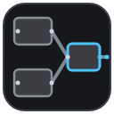

# VL Patch Viewer



在 VS Code 中将 [vvvv gamma](https://vvvv.org) 的 `.vl` 补丁文件显示为可交互的 SVG 节点图。

**完全自包含**：VL 解析器和 SVG 渲染器都内置在扩展中，不需要 Python、uv 或其他外部工具。安装后即可打开 `.vl` 文件。即使机器上没有安装 vvvv，也可以在 Windows、macOS 或 Linux 上查看补丁结构和保存的参数。

## 安装

从 [GitHub Releases](https://github.com/quantumxiaol/vl-patch-viewer/releases) 下载最新的 `vl-patch-viewer-x.y.z.vsix` 文件。

在 VS Code 中打开扩展视图，选择 **… → Install from VSIX…（从 VSIX 安装）**，然后选择下载的文件。如有提示，请重新加载 VS Code。通过 GitHub Releases 安装不需要 Marketplace 账号或 publisher ID。

也可以在终端中安装：

```sh
code --install-extension vl-patch-viewer-x.y.z.vsix
```

## 功能

- **VL 图形视图**：将节点、引脚、连线、区域、IOBox 和注释渲染为 SVG 节点图。
- **按画布查看**：在多个 Process 画布之间切换，也可以查看 Whole document。可执行区域会包含在当前画布中，独立定义不会混入。
- **节点与 IOBox 详情**：单击元素查看类别、Bounds、引脚和保存值；双击可缩放到该元素。
- **静态参数编辑**：通过受类型约束且经过校验的操作，修改输入引脚的 `DefaultValue` 或 IOBox 的 `Value`。未知元素和不安全目标会被拒绝。
- **文本与图形双视图**：编辑通过 VS Code 文本模型完成，原生支持撤销、未保存状态和保存冲突处理。
- **实时刷新**：输入（带防抖）、保存以及外部工具修改文件后自动重新渲染。
- **平移与缩放**：拖动平移、滚轮以光标为中心缩放，并提供 Fit 和 100% 按钮。
- **纯 TypeScript 渲染**：解析和布局规则移植自 [vl-patch-manipulator](https://github.com/tebjan/vvvv-skills)，见[致谢与许可](#致谢与许可)。

当前明确不支持：插入或删除节点、拖动连线、节点目录搜索、运行时值以及 vvvv 实时编译。

## 使用方法

1. 在 VS Code 中打开包含 `.vl` 文件的文件夹。
2. 在资源管理器中右键 `.vl` 文件，选择 **Open With…（打开方式）→ VL Patch Graph**。
3. 如果默认打开的是纯文本编辑器，请在命令面板中运行 **View: Reopen Editor With…**，然后选择 **VL Patch Graph**。

如果希望双击 `.vl` 文件时始终使用图形视图，请将以下设置加入 VS Code 用户 `settings.json`：

```json
"workbench.editorAssociations": {
  "*.vl": "vlPatch.viewer"
}
```

随时可以通过 **Open vl with… → Text Editor** 切换回文本编辑器，无需其他渲染配置。

### 查看和编辑保存值

1. 在 **Canvas** 下拉框中选择 Process 画布，或选择 **Whole document**。
2. 单击节点或 IOBox 打开详情面板；双击元素可放大查看。
3. 修改受支持的 `DefaultValue` 或 `Value`，然后点击 **Apply**。写入前会执行离线结构校验。
4. 使用 `Ctrl+Z` 撤销，使用 `Ctrl+S` 保存。扩展不会替你自动保存，也不会重写文档的其他部分。

目前只有输入引脚的直接 `DefaultValue` 和非 Slot Pad 的 `Value` 可以编辑。嵌套 `DefaultValue` 和 Slot pads 为只读。

## 已知限制

- 静态校验只检查 XML 结构、ID、连线及相关不变量，不能保证值的运行时类型正确，也不能保证 vvvv 编译通过。扩展不读取运行时值，也不做类型推断。
- 缩小视图时节点标签可能被截断，请放大后阅读。
- 节点类型、重载等语义信息位于 .NET 程序集中，离线时不可用；图形视图只展示文档结构和保存值。
- VL 格式会随 vvvv 版本变化。目前主要针对 vvvv gamma 8.0-0184 时期的文件测试，其他版本按兼容性尽力渲染。

## 路线图

- **Phase 2（当前）**：按画布查看、元素详情和静态参数编辑。
- **后续计划**：基于 donor 的节点插入以及更多布局操作。
- **Phase 3（待定）**：与正在运行的 vvvv 实例协作。

## 致谢与许可

- 本扩展是 [vl-patch-manipulator](https://github.com/tebjan/vvvv-skills) 的衍生作品，原作者为 **tebjan** 及 vvvv 社区。VL 解析、几何布局和 SVG 生成代码由其移植并精简为渲染与静态 XML 编辑路径。
- 本项目采用 **CC BY-SA 4.0** 许可，与上游作品一致。完整许可文本和归属说明见 [LICENSE](https://github.com/quantumxiaol/vl-patch-viewer/blob/HEAD/LICENSE)。
- [vvvv](https://vvvv.org) 和 VL 格式由 vvvv 团队开发。
- 内置运行时依赖为 [@xmldom/xmldom](https://github.com/xmldom/xmldom)（MIT）。

## 参与贡献

欢迎提交 Issue 和 Pull Request。开发环境：

```sh
npm install
npm run compile   # 或：npm run watch
npm test          # 编译并运行单元测试
# 按 F5 → Run Extension，启动扩展开发宿主
```

运行 `npm run lint` 执行静态检查，运行 `npm run package` 生成可通过 *Install from VSIX…* 安装的 `.vsix` 文件。更多约定见 [CONTRIBUTING.md](CONTRIBUTING.md)。
